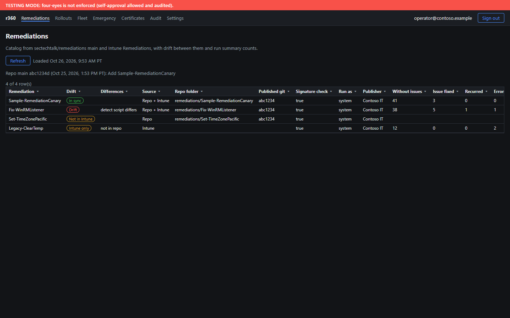

# r360 - Remediation 360

r360 is SecTechTalk's standalone tool for authoring, signing, piloting and publishing Intune and Defender remediations.
It is for the people who write and approve remediation scripts for the fleet. It is a standalone product and shares no code, identity or Azure resources with other projects.

Design: [docs/remediation-360-design.md](docs/remediation-360-design.md).



*Screenshot: the Remediations page rendered locally with fictional sample data (contoso.example). The hosted app requires Entra sign-in.*

## What it does today (Phase 1, read-only)
- **Remediations**: compares the catalog on `your-org/remediations` main with Intune Remediations. Each script shows
  In sync, Drift, Not in Intune or Intune only, with the fields that differ and run summary counts.
- **Fleet**: run state of every remediation on every device (Intune `deviceRunStates`), times in Pacific time.
- **Certificates**: the code-signing Trusted Root and Trusted Publisher profiles, thumbprint check, assignments and per-device status.
- **Settings**: your roles from `approvers.json`, your PIM status and the app configuration, read-only.
- **Rollouts, Emergency, Audit**: placeholders for later phases.

Publishing still runs through the scripts in `your-org/remediations` (`tools/Publish-Remediation.ps1`). r360 is where you check the result.

## Architecture
- Node 22 + Express in `server/`, static UI in `public/`, container image `ghcr.io/your-org/remediation-360:<yyyyMMdd-HHmm>`.
- Hosted on Azure Container Apps (scale 0-1) at the default `*.azurecontainerapps.io` FQDN.
- Sign-in: Entra auth code + PKCE via `r360-web`; the client assertion is the `id-r360` managed identity token (no secret).
- Graph: delegated read scopes only, using the signed-in operator's token.
- GitHub: App `r360-github-app`, JWT signed by Key Vault key `github-app-r360`, installation token narrowed to `remediations` read.
- No demo mode: missing settings stop the app.

## Security model
- Delegated permissions only; no application permissions, no client secrets, no stored keys.
- App registrations `r360-web` / `r360-write` trust the managed identity `id-r360` (federated credential).
  `r360-ci-signer` trusts GitHub OIDC for `your-org/remediations` `main` only.
- GitHub App and code-signing keys live in Key Vault Premium as non-exportable HSM keys.
- Access is limited to `sg-r360-operators`; r360 roles come from `approvers.json` on the remediations repo and fail closed.
- Audit table is append-only (custom role); export container is immutable (365 days).
- Every Phase 1 API route is GET; the only POST is sign-out. Security headers include a strict CSP and `frame-ancestors 'none'`.

## Getting started

### Bootstrap (Phase 0)
Requirements: PowerShell 7.4+, az (containerapp extension), gh, git, Microsoft.Graph.Authentication; signed in with
`az login` and `gh auth login` as a tenant/org admin.

```powershell
pwsh -File tools/Test-R360Prereqs.ps1                 # read-only checks
pwsh -File tools/Invoke-R360Bootstrap.ps1 -WhatIf     # dry run
pwsh -File tools/Invoke-R360Bootstrap.ps1             # real run
```
Manual clicks: Graph delegated sign-in, GitHub App "Create" and "Install" (remediations only).
Not scripted: Defender live response settings/role, CA auth context, PIM.
Deferred (gated, later): App-only merge rule on `remediations` main, once r360 can publish.

Logs: `C:\path\to\logs`.

### Test, build and deploy
```powershell
npm ci; npm test                                    # unit tests
pwsh -File tools/Publish-R360Image.ps1 -WhatIf      # dry run
pwsh -File tools/Publish-R360Image.ps1              # test, build, push ghcr.io/your-org/remediation-360:<yyyyMMdd-HHmm>, deploy, verify
```
The deploy script waits for the new revision, checks `/healthz`, the sign-in redirect, the API 401 and the startup
self-checks (managed identity token, GitHub App read), then prints a pass/fail table. The ghcr package must be public
because the Container App has no registry login; the image holds code only.

## Status and roadmap
| Phase | Scope | Status |
|---|---|---|
| 0 | Bootstrap: app registrations, managed identity, Key Vault, GitHub App, code-signing cert, infrastructure | Done |
| 1 | Read-only dashboard: Remediations, Fleet, Certificates, Settings | Live |
| 2 | Publish through r360, audit viewer and export | Planned |
| 3 | Rollouts: canary on DEVICE01, widen, retire, certificate profile management | Planned |
| 4 | Emergency path: two-person Defender and Intune actions, 4 hours, 1 device | Planned |

Four-eyes is in testing mode (self-approval allowed and audited) until it is switched to enforced. See the design doc, section 13, for the full plan.
