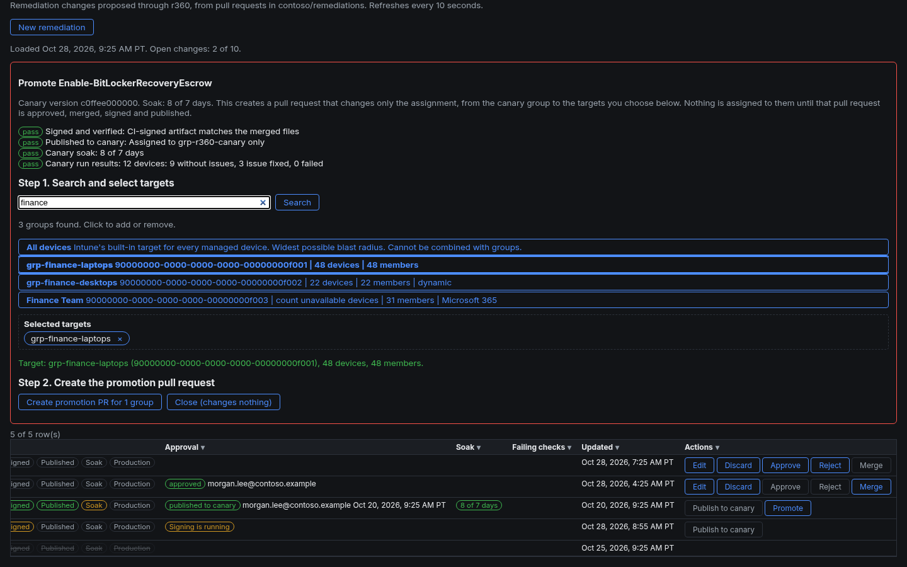
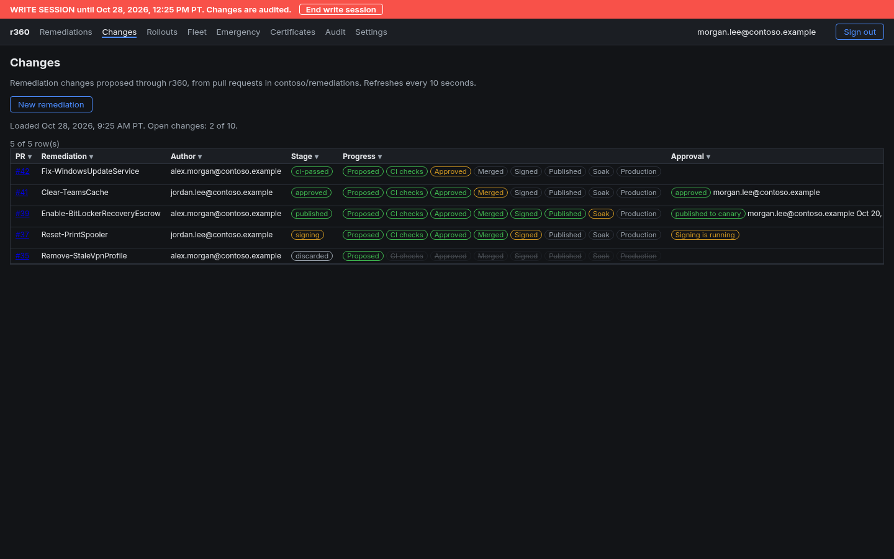
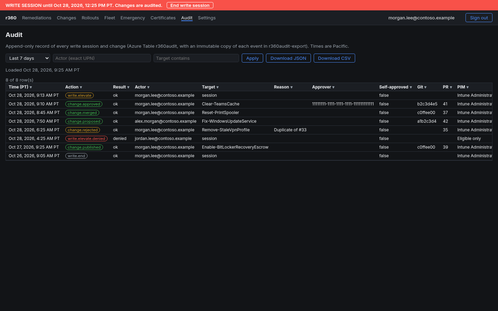

# r360 - Remediation 360

r360 is SecTechTalk's standalone tool for authoring, signing, piloting and publishing Intune and Defender remediations.
It is for the people who write and approve remediation scripts for the fleet.

Design: [docs/remediation-360-design.md](docs/remediation-360-design.md). Phase 2 plan: [docs/phase2-plan.md](docs/phase2-plan.md).


*Screenshot: the Remediations page rendered locally with fictional sample data (contoso.example). The hosted app requires Entra sign-in.*

## What it does today (Phases 1 and 2 live)

### Read-only dashboard
- **Remediations**: compares the catalog on `your-org/remediations` main with Intune Remediations. Each script shows
  In sync, Drift, Not in Intune or Intune only, with the fields that differ, run summary counts, the published git
  commit and a Soak column.
- **Fleet**: run state of every remediation on every device (Intune `deviceRunStates`), times in Pacific time.
- **Certificates**: the code-signing Trusted Root and Trusted Publisher profiles, thumbprint check, assignments and per-device status.
- **Settings**: your roles from `approvers.json`, your PIM status and the app configuration, read-only.
- **Audit**: every event (sign-in, elevate, propose, approve, merge, sign, publish, promote, denials) with date range,
  actor and target filters, per-column filters, and JSON/CSV download. Times are Pacific.

### Change pipeline: author, approve, sign, publish, promote
1. **Write session (S2)**: **Elevate to write** signs you in again through `r360-write` (only
   `DeviceManagementScripts.ReadWrite.All`) for 8 hours. The server enforces the end time; a red banner shows when it
   ends. Elevating needs an `approvers.json` role and is refused unless the audit event was stored first.
2. **Author (S3)**: create or edit a remediation in r360; it becomes a branch and pull request on `remediations`,
   opened by the r360 GitHub App with the author recorded.
3. **Approve and merge (S4)**: four-eyes approval, reject, and merge from r360, all audited, with on-demand signing verification.
4. **Sign (S1)**: CI signs the scripts with the Key Vault HSM code-signing key through GitHub OIDC; r360 checks the signature.
5. **Publish to canary (S5)**: the exact CI-signed artifact goes to the Intune canary group with signature enforcement on.
   The Intune description is stamped with the git commit, author, approver and publisher. Re-publishing the same commit is a no-op.
6. **Promote (S6)**: after the canary soak (7 days by default) a promotion PR changes only the assignment, from canary to
   production. The **promote panel** has a group picker: one or more Entra groups (up to 20, with device and member
   counts) or All devices, which is exclusive. Evidence (soak days, run errors, drift) is shown before you confirm.
7. **App-only merge (S7)**: a ruleset on `remediations` main lets only the r360 GitHub App merge, so every published change
   came through r360's approval chain.

### Safeguards
- **Four-eyes testing mode**: until it is switched to enforced, the author may approve their own change. Every
  self-approval is loud: red TESTING MODE banner, audit flag, PR comment and Intune description stamp. In enforced mode
  the approver must be a different person.
- **Soak override**: the soak period can be lowered only with a written reason. Any value other than 7 days shows a red
  SOAK OVERRIDE banner and is recorded in the audit trail and the promotion PR.
- **Multi-group edit limit**: r360 does not edit a remediation that is already assigned beyond the canary group (to
  several groups or All devices); it must be changed through a new promotion.
- **Provenance gate**: a commit is published only if r360 has audit records of its proposal, approval and merge.
- **Break-glass**: the repository owner can lift the App-only merge rule with a documented script switch and restore it afterwards.

## Architecture
- Node 22 + Express in `server/`, static UI in `public/`, container image `ghcr.io/your-org/remediation-360:<yyyyMMdd-HHmm>`.
- Hosted on Azure Container Apps (scale 0-1) at the default `*.azurecontainerapps.io` FQDN.
- Sign-in: Entra auth code + PKCE via `r360-web`; the client assertion is the `id-r360` managed identity token (no secret).
- Graph: delegated scopes only, using the signed-in operator's token. Read scopes by default; the write scope only in a write session.
- GitHub: App `r360-github-app`, JWT signed by a Key Vault key, installation tokens scoped to the `remediations` repo.
- No demo mode: missing settings stop the app.

## Security model
- Delegated permissions only; no application permissions, no client secrets, no stored keys.
- App registrations `r360-web` / `r360-write` trust the managed identity `id-r360` (federated credential).
  `r360-ci-signer` trusts GitHub OIDC for `your-org/remediations` `main` only.
- GitHub App and code-signing keys live in Key Vault Premium as non-exportable HSM keys.
- Access is limited to an operators group; r360 roles come from `approvers.json` on the remediations repo and fail closed.
- Audit table is append-only; each event is also written as its own blob in a container with a 365-day immutability
  policy. No audit, no write.
- Every state-changing request needs the right `Origin`, `Content-Type: application/json` and a per-session CSRF token.
  Sign-in and elevation responses are bound to a nonce, checked by MSAL and again by r360.
- Security headers include a strict CSP and `frame-ancestors 'none'`.

## Screenshots
| | |
|---|---|
|  |  |
| *Promote panel with the group picker* | *Changes: author, approve, publish* |
|  | |
| *Audit trail* | |

## Getting started

### Bootstrap (Phase 0)
Requirements: PowerShell 7.4+, az (containerapp extension), gh, git, Microsoft.Graph.Authentication; signed in with
`az login` and `gh auth login` as a tenant/org admin.

```powershell
pwsh -File tools/Test-R360Prereqs.ps1                 # read-only checks
pwsh -File tools/Invoke-R360Bootstrap.ps1 -WhatIf     # dry run
pwsh -File tools/Invoke-R360Bootstrap.ps1             # real run
pwsh -File tools/Set-R360CiSigningConfig.ps1 -WhatIf  # CI signing (S1)
pwsh -File tools/Set-R360RulesetAppOnly.ps1 -WhatIf   # App-only merge (S7); -Remove is the owner break-glass
```
Manual clicks: Graph delegated sign-in, GitHub App "Create" and "Install" (remediations only).
Not scripted: Defender live response settings/role, CA auth context, PIM.

### Test, build and deploy
```powershell
npm ci; npm test                                    # unit tests
pwsh -File tools/Publish-R360Image.ps1 -WhatIf      # dry run
pwsh -File tools/Publish-R360Image.ps1              # test, build, push ghcr.io/your-org/remediation-360:<yyyyMMdd-HHmm>, deploy, verify
```
The deploy script waits for the new revision, checks `/healthz`, the sign-in redirect, the API 401 and the startup
self-checks (managed identity token, GitHub App read), then prints a pass/fail table. Deploys keep existing environment
settings. The ghcr package is public because the Container App has no registry login; the image holds code only.

## Status and roadmap
| Phase | Scope | Status |
|---|---|---|
| 0 | Bootstrap: app registrations, managed identity, Key Vault, GitHub App, code-signing cert, infrastructure | Done |
| 1 | Read-only dashboard: Remediations, Fleet, Certificates, Settings | Live |
| 2 | S1 CI signing, S2 write session and audit, S3 author, S4 approve/merge, S5 publish to canary, S6 promote with soak gate, S7 App-only merge | Done (2026-10-27) |
| 3 | Rollouts: widen, retire, certificate profile management | Planned |
| 4 | Emergency path: two-person Defender and Intune actions, 4 hours, 1 device | Planned |

Four-eyes is in testing mode (self-approval allowed and audited) until it is switched to enforced.
