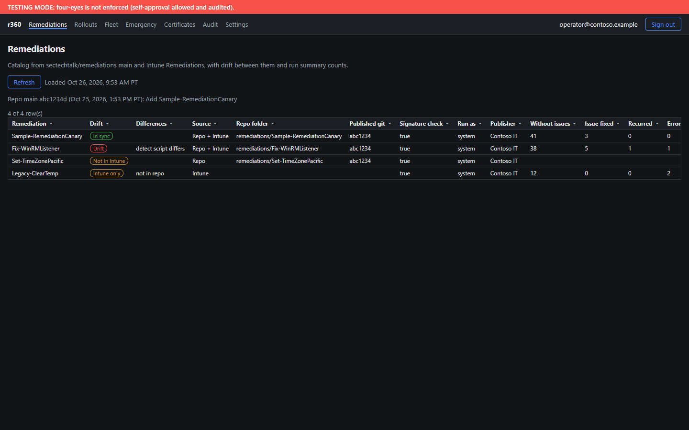
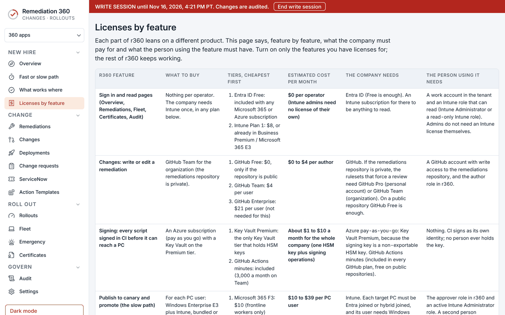
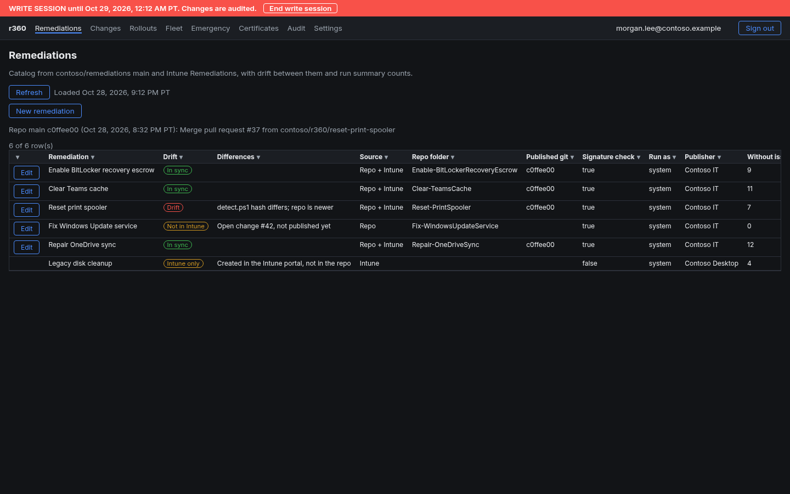
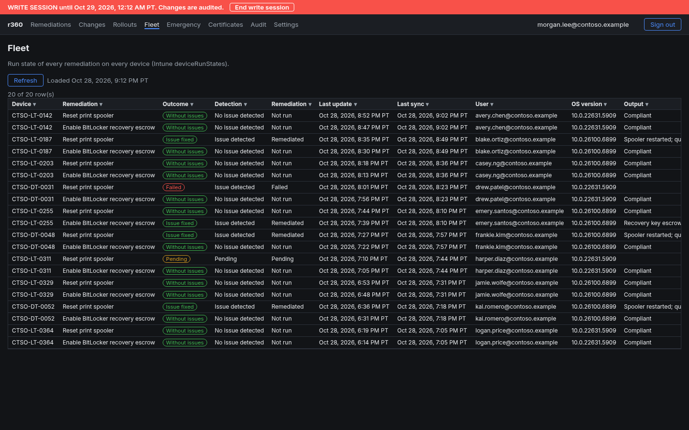
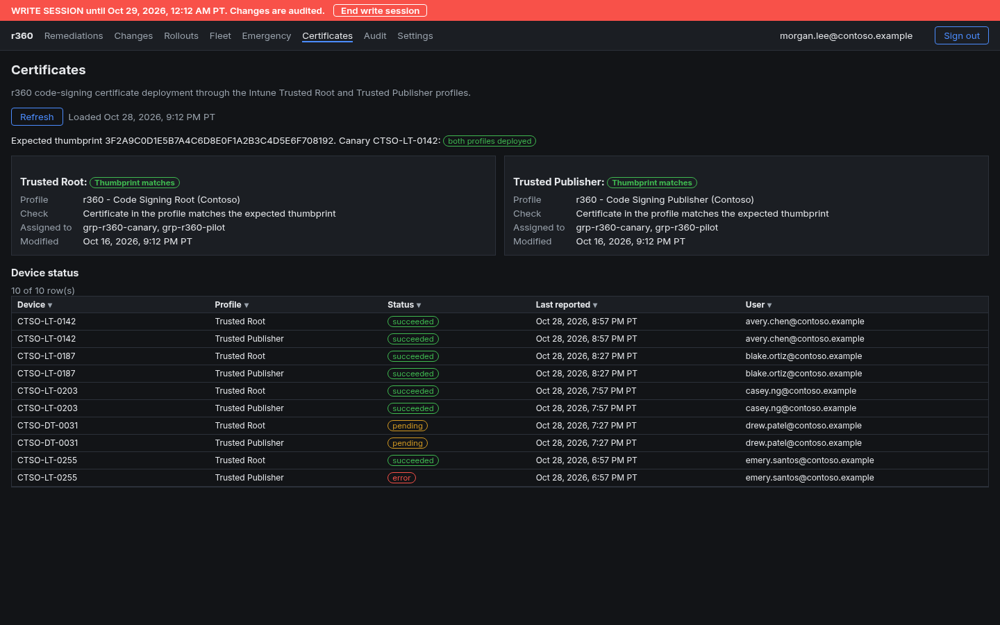
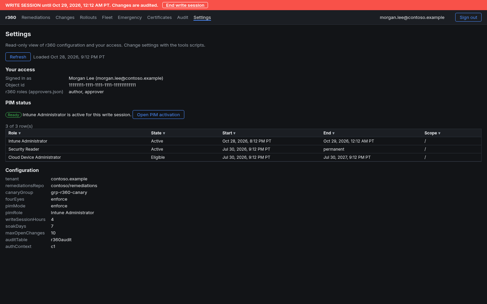
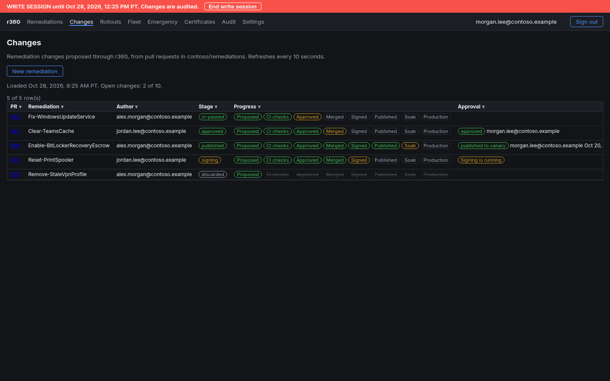
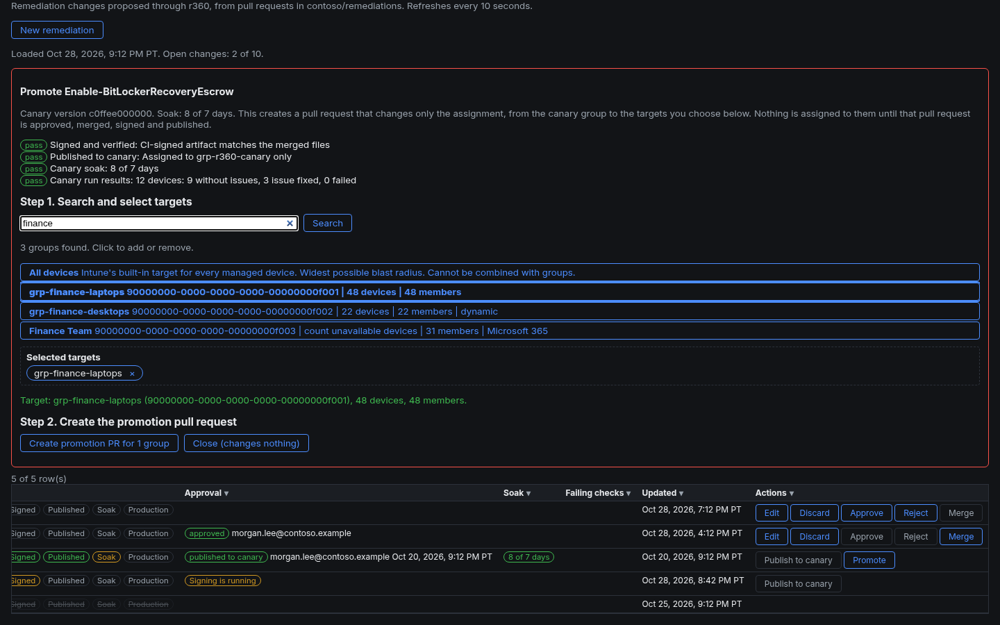
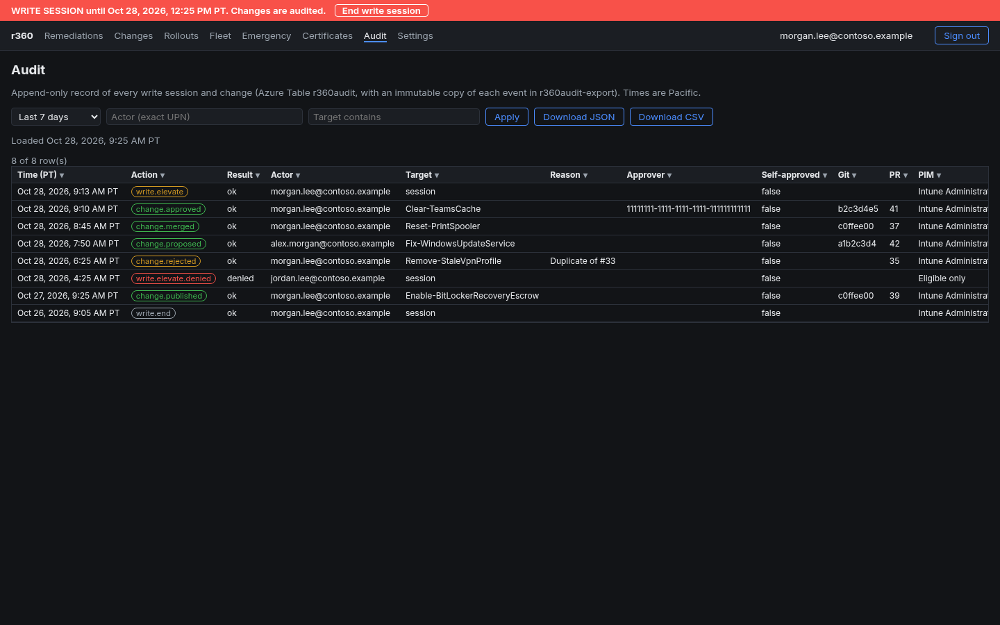
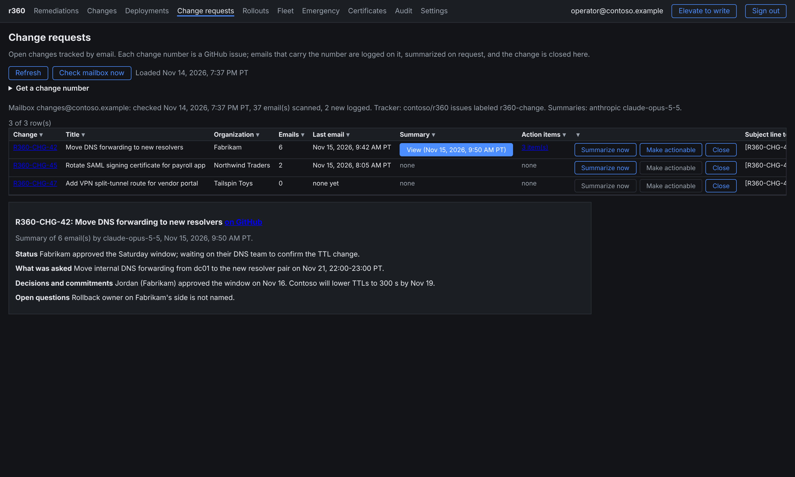

# r360 - Remediation 360

r360 is SecTechTalk's standalone tool for authoring, signing, piloting and publishing Intune and Defender remediations.
It is for the people who write and approve remediation scripts for the fleet.

Design: [docs/remediation-360-design.md](docs/remediation-360-design.md). Phase 2 plan: [docs/phase2-plan.md](docs/phase2-plan.md).
How-to guides: [docs/guides/](docs/guides/README.md) (fast or slow path, what is supported, device requirements, email-driven change requests, ServiceNow).

r360 opens on **New hire > Overview**, written for someone new to Intune, Defender, GitHub and CI/CD. The rail groups
every page in four sections:

| Section | Pages |
|---|---|
| New hire | Overview (the default page), Fast or slow path, What works where, Licenses by feature |
| Change | Remediations, Changes, Deployments, Change requests, ServiceNow, Action Templates |
| Roll out | Rollouts (Phase 3, not built yet), Fleet, Emergency, Certificates |
| Govern | Audit, Settings |

Every page has its own URL (`#overview`, `#emergency`, ...), so Back, refresh and shared links work. Light and dark follow
the operating system, with a toggle in the rail. The 360 app switcher at the top of the rail opens the other 360 apps.



*Screenshot: the Remediations page rendered locally with fictional sample data (contoso.example). The running app requires Entra sign-in.*

## What it does today (Phases 0, 1, 2 and 4 done)

### New hire
- **Overview**: what r360 does and does not do, the seven steps every change follows (ask, write, review, sign, canary,
  promote, watch), each linked to the page where it happens, and a first-week checklist.
- **Fast or slow path**: when to act on one PC now through Defender (Emergency) and when to ship a reviewed fix to many PCs
  through Intune (Remediations).
- **What works where**: what r360 can do on a PC by its user's license (none, Business Premium, E3, E5) and its join state
  (Entra joined, hybrid, registered, AD only, not joined).
- **Licenses by feature**: for each r360 feature, what to buy, the tiers cheapest first, the estimated cost per month, what
  the company needs and what the person using it needs. US list prices, annual commitment, checked 2026-11-16.



### Read-only dashboard
- **Remediations**: compares the catalog on `your-org/remediations` main with Intune Remediations. Each script shows
  In sync, Drift, Not in Intune or Intune only, with the fields that differ, run summary counts, the published git
  commit and a Soak column.
- **Fleet**: run state of every remediation on every device (Intune `deviceRunStates`), times in Pacific time.
- **Certificates**: the code-signing Trusted Root and Trusted Publisher profiles, thumbprint check, assignments and per-device status.
  Every publish adds its target to both profiles first, so signed scripts can run wherever they are assigned.
- **Settings**: your roles from `approvers.json`, your PIM status and the app configuration, read-only.
- **Audit**: every event (sign-in, elevate, propose, approve, merge, sign, publish, promote, denials) with date range,
  actor and target filters, per-column filters, and JSON/CSV download. Times are Pacific.

### Change pipeline: author, approve, sign, publish, promote
1. **Write session (S2)**: **Elevate to write** signs you in again through `r360-write` (only
   `DeviceManagementScripts.ReadWrite.All`, plus `DeviceManagementConfiguration.ReadWrite.All` used solely to add publish
   targets to the two code-signing profiles) for 8 hours. The server enforces the end time; a red banner shows when it
   ends. Elevating needs an `approvers.json` role and is refused unless the audit event was stored first.
2. **Author (S3)**: create or edit a remediation in r360; it becomes a branch and pull request on `remediations`,
   opened by the r360 GitHub App with the author recorded.
3. **Approve and merge (S4)**: four-eyes approval, reject, and merge from r360, all audited, with on-demand signing verification.
4. **Sign (S1)**: CI signs the scripts with the Key Vault HSM code-signing key through GitHub OIDC; r360 checks the signature.
5. **Publish to canary (S5)**: the exact CI-signed artifact goes to the Intune canary group with signature enforcement on.
   The Intune description is stamped with the git commit, author, approver and publisher. Re-publishing the same commit is a no-op.
6. **Promote (S6)**: after the canary soak (7 days by default) a promotion PR changes only the assignment, from canary to
   production. The **promote panel** has a group picker: one or more Entra groups (up to 20, with device and member
   counts) or All devices, which is exclusive. Evidence (soak days, run errors, drift) is shown before you confirm.
7. **App-only merge (S7)**: a ruleset on `remediations` main lets only the r360 GitHub App merge, so every published change
   came through r360's approval chain.

### Emergency: the Defender fast path (Phase 4, Track 1)
One Microsoft Defender for Endpoint action on one device, approved by a second person, running in minutes. Actions:
isolate or release (full or selective), antivirus scan, stop and quarantine a file, collect an investigation package,
restrict or unrestrict app execution. Each action lists the Defender plans it needs (Plan 1, Defender for Business, Plan 2).
The requester finds the device in Defender, picks the action and says why; an `emergencyApprover` must approve within
4 hours, and the action runs with the approver's own delegated Defender token. Requests, approvals, refusals and results
live only in the audit trail (`emergency.*` events). Approvers need a Defender role with **Active remediation actions**.
Not built: Intune on-demand remediation (Track 2) and live response.

### Deployments lane (Terraform through GitHub Actions)
A second lane for configuration kept as Terraform, such as a test tenant's app registrations and groups. r360 is the control
plane and GitHub Actions does the running: a change is a pull request on the target repo with the plan posted on it, merging
(from r360's **Merge and apply** or GitHub) starts the apply behind the target's GitHub environment, and a nightly plan flags
drift. The **Deployments** page shows each target's last apply, drift state, open changes with their plan and recent runs with
log links, and every finished run is recorded in Audit. Each target signs in with GitHub OIDC (no secrets). Four-eyes is off
for this lane for now. Setup: [docs/deployments.md](docs/deployments.md); runner: `.github/workflows/r360-terraform.yml`.

### Change requests (tracked by email)
**Get change number** opens a GitHub issue labeled `r360-change` and returns `R360-CHG-<n>`. Organizations email the
shared change mailbox with that number; r360 logs each email on the issue (sender, time, subject), and
**Summarize now** summarizes the thread with Claude (or OpenAI / Azure OpenAI; until an API key is set, Claude Code on the operator's PC does it through `tools/Watch-R360Summaries.ps1`), with an optional **Make actionable** task
checklist. Changes are closed from r360, and the **Change requests** page lists the open ones. The mailbox is read with the
operator's own delegated token (Mail.Read.Shared + Full Access), never an application permission. Setup and details:
[docs/change-requests.md](docs/change-requests.md); setup script: `tools/Set-R360ChangeRequests.ps1`.

### ServiceNow search
The **ServiceNow** page searches ServiceNow read-only (requested items, incidents, change requests, catalog tasks) by free
text, a preconfigured query from `config/servicenow-queries.json` (changed only by pull request), a saved query, or any
query pasted from a ServiceNow list view. Each result shows the r360 change request that mentions its number, or
**Create issue** to open one linked to the item. The ServiceNow password is a Key Vault secret read at run time. Details:
[docs/servicenow.md](docs/servicenow.md); setup script: `tools/Set-R360ServiceNow.ps1`.

### Action Templates (placeholder)
Named actions (often a script) that will run on items from a ServiceNow query. The page and the `actionTemplates` field in
the queries file exist; r360 shows the templates but does not run them yet.

### Safeguards
- **Four-eyes testing mode**: until it is switched to enforced, the author may approve their own change. Every
  self-approval is loud: red TESTING MODE banner, audit flag, PR comment and Intune description stamp. In enforced mode
  the approver must be a different person.
- **Soak override**: the soak period can be lowered only with a written reason. Any value other than 7 days shows a red
  SOAK OVERRIDE banner and is recorded in the audit trail and the promotion PR.
- **Multi-group edit limit**: r360 does not edit a remediation that is already assigned beyond the canary group (to
  several groups or All devices); it must be changed through a new promotion.
- **Provenance gate**: a commit is published only if r360 has audit records of its proposal, approval and merge.
- **Break-glass**: the repository owner can lift the App-only merge rule with a documented script switch and restore it afterwards.

## Architecture
- Node 22 + Express in `server/`, static UI in `public/`, container image `ghcr.io/your-org/remediation-360:<yyyyMMdd-HHmm>`.
- Runs on a local Windows PC as a private, always-on Docker container: `http://localhost:3660`, bound to 127.0.0.1 only,
  `--restart always`, image built on that PC from a clean worktree of `origin/main` (nothing is pulled from a registry).
  Installed and updated by `tools/Install-R360Local.ps1`. The container holds no secret, certificate or key: it gets
  short-lived tokens from the PC's Azure Arc managed identity through `tools/r360-identity-helper.mjs` (a SYSTEM scheduled
  task on 127.0.0.1:3661 with an allow list of three resources), which the app registrations trust exactly as they trust
  `id-r360` in Azure. The change-request summary API key is read from Key Vault at startup.
- Azure Container Apps hosting (scale 0-1, default `*.azurecontainerapps.io` FQDN) still exists but is deactivated, not
  deleted, until r360 is published.
- Sign-in: Entra auth code + PKCE via `r360-web`; the client assertion is the `id-r360` managed identity token (no secret).
- Graph: delegated scopes only, using the signed-in operator's token. Read scopes by default; the write scope only in a write session.
- GitHub: App `r360-github-app`, JWT signed by a Key Vault key, installation tokens scoped to the `remediations` repo.
- No demo mode: missing settings stop the app.

## Security model
- Delegated permissions only; no application permissions, no client secrets, no stored keys. The one exception is the
  optional summary provider API key for change requests, kept in Key Vault and read by the managed identity.
- App registrations `r360-web` / `r360-write` trust the managed identity `id-r360` (federated credential).
  `r360-ci-signer` trusts GitHub OIDC for `your-org/remediations` `main` only.
- GitHub App and code-signing keys live in Key Vault Premium as non-exportable HSM keys.
- Access is limited to an operators group; r360 roles come from `approvers.json` on the remediations repo and fail closed.
- Audit table is append-only; each event is also written as its own blob in a container with a 365-day immutability
  policy. No audit, no write.
- Every state-changing request needs the right `Origin`, `Content-Type: application/json` and a per-session CSRF token.
  Sign-in and elevation responses are bound to a nonce, checked by MSAL and again by r360.
- Security headers include a strict CSP and `frame-ancestors 'none'`.
- Every pull request runs a security gate (`.github/workflows/security.yml`): `npm audit` fails on a high or critical
  advisory in a shipped package, gitleaks scans for committed secrets, and the unit tests run. Actions are pinned to commit
  SHAs and Dependabot keeps npm packages and actions current.

## Screenshots
All screenshots are local renders of the real UI with fictional sample data (contoso.example). No tenant data.

| | |
|---|---|
|  |  |
| *Remediations: repo vs Intune drift and run counts* | *Fleet: per-device run state for every remediation* |
|  |  |
| *Certificates: signing cert profiles and device status* | *Settings: your roles, PIM status and configuration* |
|  |  |
| *Changes: author, approve, publish* | *Promote panel with the group picker* |
|  |  |
| *Audit trail* | *Change requests tracked by email* |

## Getting started

### Bootstrap (Phase 0)
Requirements: PowerShell 7.4+, az (containerapp extension), gh, git, Microsoft.Graph.Authentication; signed in with
`az login` and `gh auth login` as a tenant/org admin.

```powershell
pwsh -File tools/Test-R360Prereqs.ps1                 # read-only checks
pwsh -File tools/Invoke-R360Bootstrap.ps1 -WhatIf     # dry run
pwsh -File tools/Invoke-R360Bootstrap.ps1             # real run
pwsh -File tools/Set-R360CiSigningConfig.ps1 -WhatIf  # CI signing (S1)
pwsh -File tools/Set-R360RulesetAppOnly.ps1 -WhatIf   # App-only merge (S7); -Remove is the owner break-glass
pwsh -File tools/Set-R360DeployTargets.ps1 -Path ./deploy-targets.json -WhatIf  # Deployments lane targets
pwsh -File tools/Set-R360ChangeRequests.ps1                 # Change requests (dry run; -Apply to set up, -SetApiKey for in-app summaries)
pwsh -File tools/Set-R360ServiceNow.ps1                     # ServiceNow search (dry run; -Apply to set up)
pwsh -File tools/Set-R360SigningProfileTargets.ps1          # Catch-up: add every existing promotion target to both code-signing profiles
pwsh -File tools/Watch-R360Summaries.ps1 -Install -Apply    # Until the API key exists: Summarize now via Claude Code on this PC
```
Manual clicks: Graph delegated sign-in, GitHub App "Create" and "Install" (remediations only).
Not scripted: Defender role with Active remediation actions (emergency approvers), live response settings, CA auth context, PIM.

### Test
```powershell
npm ci; npm test                                    # unit tests
```

### Run it locally, always on (how r360 is hosted today)
Requirements: Docker Desktop (starts at logon), the PC onboarded to Azure Arc, PowerShell 7.4+ in an elevated window.
```powershell
pwsh -File tools/Install-R360Local.ps1                # dry run: checks and shows what it would do
pwsh -File tools/Install-R360Local.ps1 -Apply         # install and start on http://localhost:3660
pwsh -File tools/Install-R360Local.ps1 -Update -Apply # after a merge: pull main into the run copy, rebuild, restart
pwsh -File tools/Install-R360Local.ps1 -Status        # helper task, container, health
pwsh -File tools/Install-R360Local.ps1 -Remove -Apply # stop and remove (the data folder is kept)
```
Azure changes made by `-Apply` are additive only (redirect URIs, federated credential, role assignments); reads from Azure
are retried, and redirect URIs are never rewritten from a failed read. The script never stops, scales or deletes the Azure
Container App.

### Azure Container Apps (deactivated)
```powershell
pwsh -File tools/Publish-R360Image.ps1 -WhatIf      # dry run
pwsh -File tools/Publish-R360Image.ps1              # test, build, push ghcr.io/your-org/remediation-360:<yyyyMMdd-HHmm>, deploy, verify
```
Kept for when r360 is published. The deploy script waits for the new revision, checks `/healthz`, the sign-in redirect,
the API 401 and the startup self-checks (managed identity token, GitHub App read), then prints a pass/fail table.

## Status and roadmap
| Phase | Scope | Status |
|---|---|---|
| 0 | Bootstrap: app registrations, managed identity, Key Vault, GitHub App, code-signing cert, infrastructure | Done |
| 1 | Read-only dashboard: Remediations, Fleet, Certificates, Settings | Done |
| 2 | S1 CI signing, S2 write session and audit, S3 author, S4 approve/merge, S5 publish to canary, S6 promote with soak gate, S7 App-only merge | Done (2026-10-27) |
| 3 | Rollouts: widen, retire, certificate profile management | Planned |
| D | Deployments lane: Terraform PR plan, apply on merge, drift, run audit | Built (2026-11-12), first target f360-lab |
| C | Change requests: change numbers on GitHub issues, shared mailbox tracking, summaries, close | Built (2026-11-15) |
| S | ServiceNow search: free text, preconfigured and saved queries, GitHub issue per item (docs/servicenow.md) | Built (2026-11-15) |
| T | Action Templates: named actions (often a script) run on items from a ServiceNow query | Placeholder page (2026-11-15) |
| 4 | Emergency path: two-person Defender actions, 4 hours, 1 device (Track 1). Intune on-demand remediation (Track 2) and live response not built | Built (2026-11-16) |
| N | New hire section: Overview as the default page, Fast or slow path, What works where, Licenses by feature with what to buy and cost | Built (2026-11-16) |
| H | Local hosting: always-on private Docker container with the Arc managed identity; Azure Container App deactivated | Live (2026-11-15) |

Four-eyes is in testing mode (self-approval allowed and audited) until it is switched to enforced.
